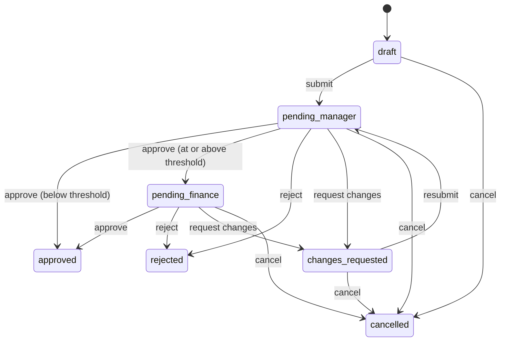

# FlowApprove

Purchase-request approvals: a requester submits a request with a vendor quote, it goes to their
manager and, above a threshold, to finance; everyone sees changes live, gets email, and every
action lands in an append-only audit log. An AI check compares the quote with the request.

**[Live demo](https://ca-flowapprove.proudmoss-4839f83c.eastus2.azurecontainerapps.io)**: pick a persona and try both sides of a request (sample data, reset nightly).

**Status: in development.** Working locally: sign-in as demo personas, raising and editing
requests, PDF quotes, the full approval path with separation of duties, live updates and the
audit trail, the AI quote check and email notifications, deployed to Azure. Next: a custom
domain and Entra ID sign-in.

## Stack

| Layer | Choice |
|---|---|
| API | Node 24 + TypeScript, Fastify, Zod, Prisma 7, Socket.IO |
| Web | React 19 + TypeScript, Vite |
| Database | PostgreSQL 18 (Docker locally, Neon in production) |
| Cloud | Azure Container Apps, Entra ID, Key Vault, Blob Storage, Communication Services, Terraform |
| Tooling | [mise](https://mise.jdx.dev) (toolchain), [just](https://just.systems) (tasks), GitHub Actions |

## How approvals work

The rules live in one place, [`api/src/workflow.ts`](api/src/workflow.ts), as pure functions
that both the API and the UI ask "what can this person do now?":



- **Separation of duties:** nobody approves their own request, only the requester's manager
  decides the manager step, and the finance approver must be someone other than the manager
  who approved it. Admins manage users but can't approve.
- **Audit log:** a database trigger rejects updates and deletes on `audit_events`, so history
  can't be rewritten by application code.

## The AI quote check

When a request is submitted with a quote attached, a model reads the PDF and the request page
shows whether the quote matches: vendor, total, validity date and items, side by side. The
requester can run it before submitting, and the approver can run it again.

- **The model extracts; code decides.** The model returns the quote's facts as structured
  output (vendor, total, currency, valid-until date, line items) and judges only whether the
  items fit the request. The total is compared to the cent, the date against today and the
  vendor name after normalising, all in [`compare.ts`](api/src/quote/compare.ts), so a model
  can't call a quote a match when the numbers differ.
- **Any of three providers.** Claude, OpenAI or Gemini through each one's official SDK, chosen
  with `QUOTE_CHECK_MODEL` from an allowlist; the check is off without that provider's key.
- **Safe with untrusted files.** The quote text is passed as data with an instruction to ignore
  anything inside it; scanned PDFs with no text come back as "couldn't confirm", not a guess.
- **Recorded and limited.** Each check is stored with its model and tokens, appears in the
  request's audit history, and is rate-limited per person.

On the [demo quotes](demo/), Claude Haiku 5.5, GPT-6 Luna and Gemini 3.5 Flash-Lite all passed
the matching quote and caught each deliberate mismatch (wrong total, expired, wrong vendor),
in 1 to 5 seconds and under 2,000 tokens a check.

## Email notifications

The manager hears when a request needs them, finance when one passes their threshold, and the
requester when it's approved, rejected or sent back (with the comment). Cancelling tells the
approver it was waiting on.

- **Outbox pattern.** Emails are written in the same database transaction as the decision, so
  one is never saved without the other. A background worker sends them, retrying failures at
  growing intervals (30 s up to 32 min, five attempts) and recording the outcome. Rows are
  claimed with `FOR UPDATE SKIP LOCKED`, so several instances can deliver without sending
  anything twice.
- **Azure Communication Services** sends them in Azure (`EMAIL_DELIVERY=acs`), signed in with
  the app's managed identity, so there's no email key to store.
- **In the app**, the ✉ button shows each person the notifications sent to them. On the demo,
  whose people and addresses are made up, that's where they appear instead of being sent.

## Quick start

```bash
mise install          # node, just, terraform at pinned versions
cp .env.example .env  # add a model key to switch on the AI quote check
just setup            # install dependencies, generate the database client
just migrate          # start Postgres 18 in Docker (port 5433) and apply migrations
just dev-api          # terminal 1: API on http://localhost:8080
just dev-web          # terminal 2: web app on http://localhost:5174
```

`just seed` loads six demo personas (a director, a manager, two engineers, finance and an admin)
and requests in every state. Sign in as Rita to raise a request and as Mo, her manager, in
another browser to approve it, and watch both pages update live.
[`demo/`](demo/) has fictional vendor quotes to attach, including a few that deliberately don't
match their request.

`just check` runs what CI runs. API tests use their own `flowapprove_test` database, so they
never touch the data you're working with.

## License

[MIT](LICENSE)
