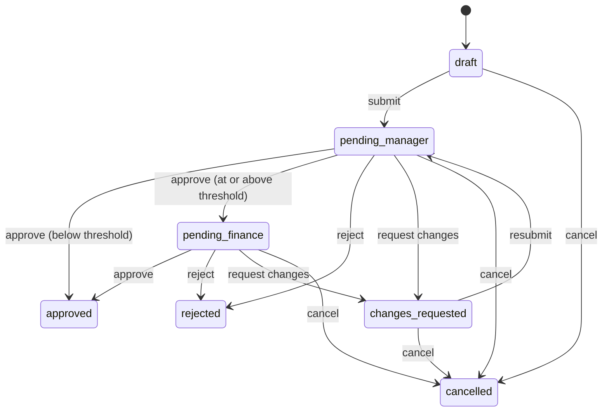

# FlowApprove

Purchase-request approvals: a requester submits a request with a vendor quote, it goes to their
manager and, above a threshold, to finance; everyone sees changes live, gets email, and every
action lands in an append-only audit log. An AI check compares the quote with the request.

**Status: in development.** Working locally: sign-in as demo personas, raising and editing
requests, PDF quotes, the full approval path with separation of duties, live updates and the
audit trail. Next: email notifications, the AI quote check, and the Azure deployment.

## Stack

| Layer | Choice |
|---|---|
| API | Node 24 + TypeScript, Fastify, Zod, Prisma 7, Socket.IO |
| Web | React 19 + TypeScript, Vite |
| Database | PostgreSQL 18 (Docker locally, Neon in production) |
| Cloud | Azure Container Apps, Entra ID, Key Vault, Blob Storage, Communication Services, Terraform |
| Tooling | [mise](https://mise.jdx.dev) (toolchain), [just](https://just.systems) (tasks), GitHub Actions |

## How approvals work

The rules live in one place, [`api/src/workflow.ts`](api/src/workflow.ts), as pure functions
that both the API and the UI ask "what can this person do now?":



- **Separation of duties:** nobody approves their own request, only the requester's manager
  decides the manager step, and the finance approver must be someone other than the manager
  who approved it. Admins manage users but can't approve.
- **Audit log:** a database trigger rejects updates and deletes on `audit_events`, so history
  can't be rewritten by application code.

## Quick start

```bash
mise install          # node, just, terraform at pinned versions
cp .env.example .env  # optional: AI keys, finance threshold
just setup            # install dependencies, generate the database client
just migrate          # start Postgres 18 in Docker (port 5433) and apply migrations
just dev-api          # terminal 1: API on http://localhost:8080
just dev-web          # terminal 2: web app on http://localhost:5174
```

`just seed` loads six demo personas (a director, a manager, two engineers, finance and an admin)
and requests in every state. Sign in as Rita to raise a request and as Mo, her manager, in
another browser to approve it, and watch both pages update live.
[`demo/`](demo/) has fictional vendor quotes to attach, including a few that deliberately don't
match their request.

`just check` runs what CI runs. API tests use their own `flowapprove_test` database, so they
never touch the data you're working with.

## License

[MIT](LICENSE)
